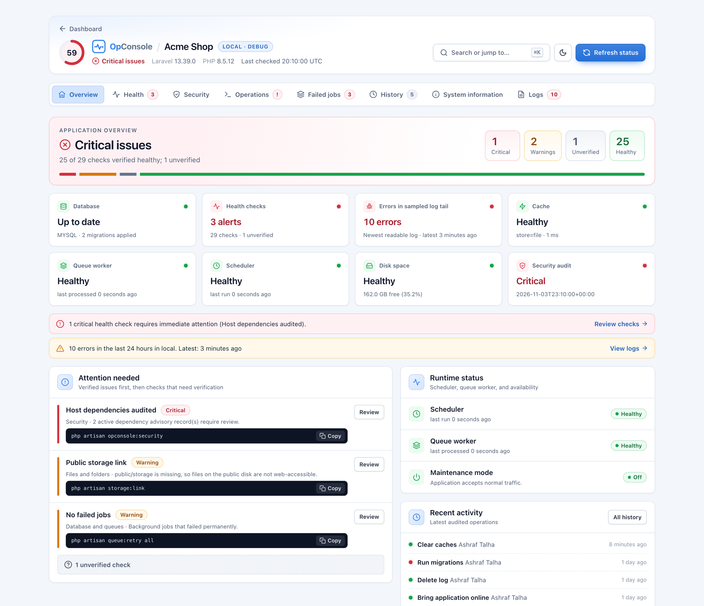
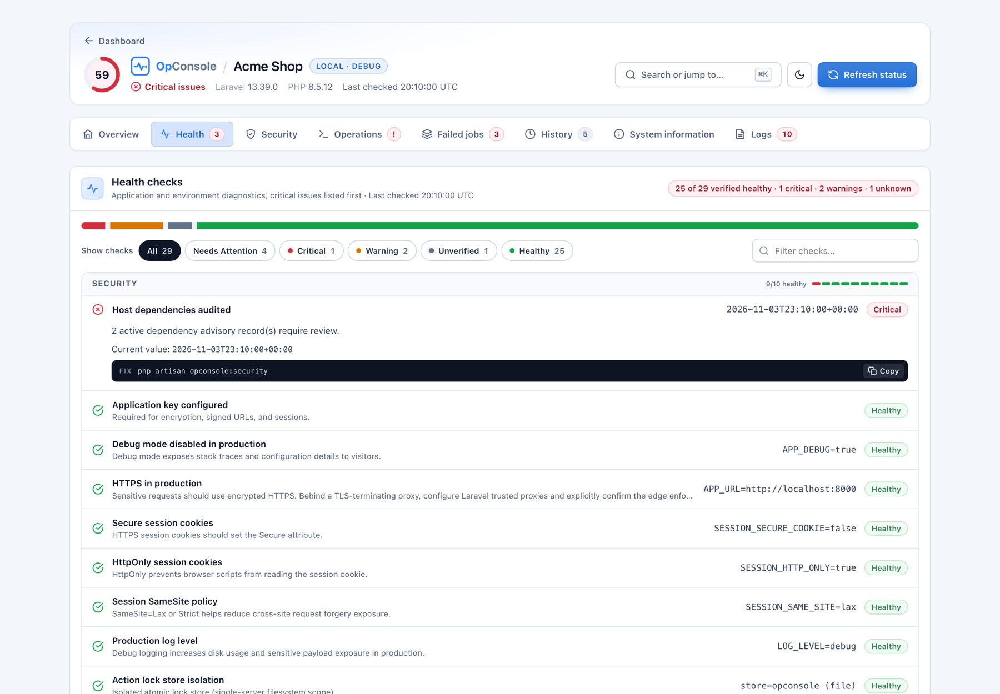
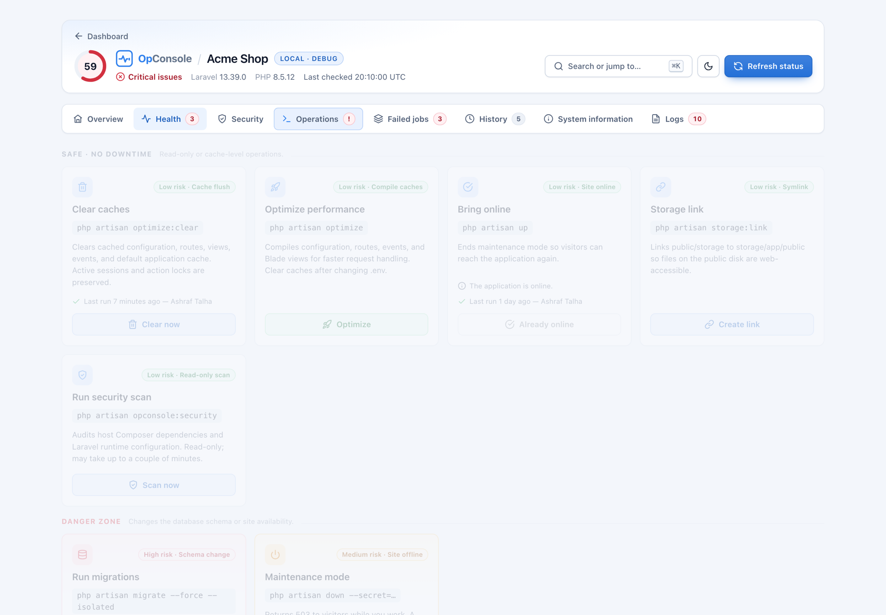
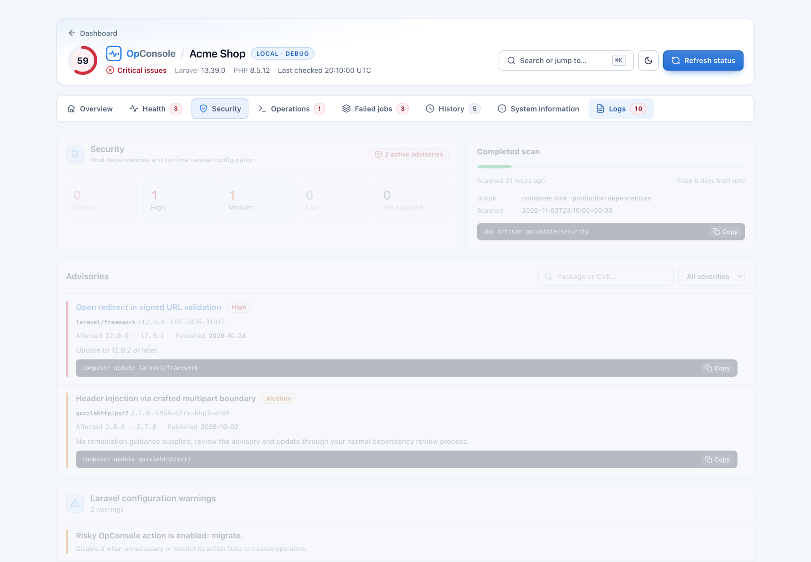
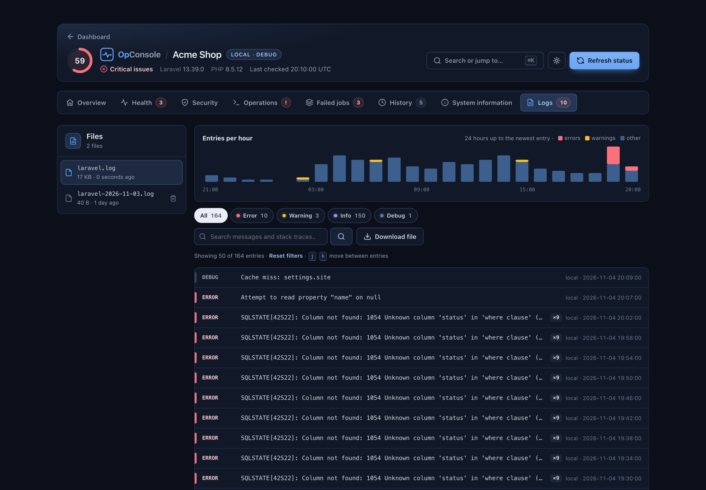
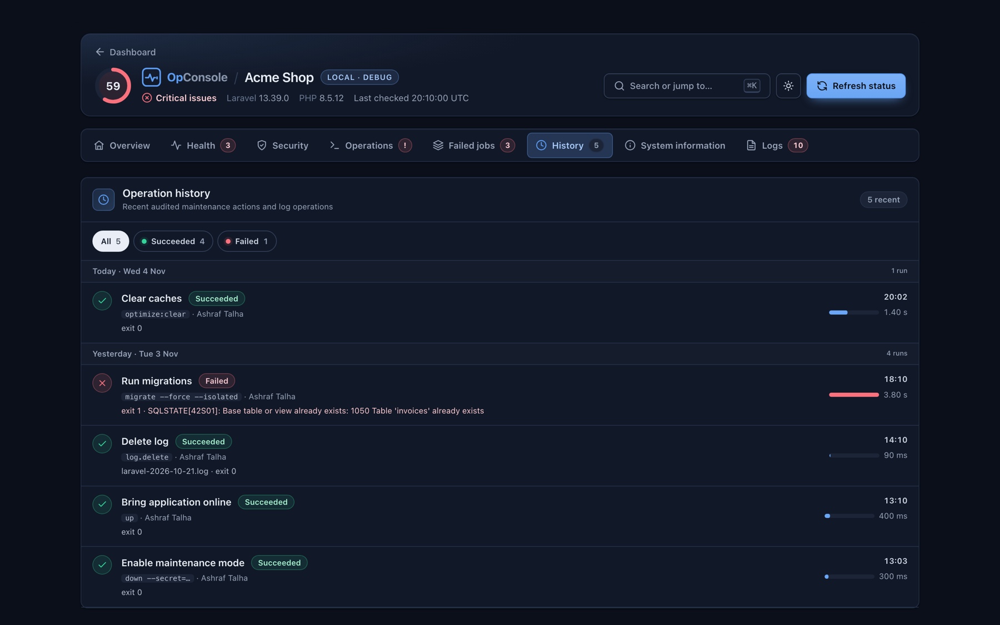
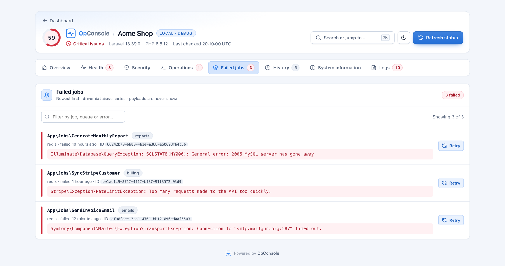

<p align="center"></p>

<p align="center"><strong>Monitor. Diagnose. Maintain.</strong><br>An operations console for Laravel: health checks, safe Artisan operations, a security audit and a log viewer, all behind Gates.</p>

<p align="center">
<a href="https://packagist.org/packages/ashraftalha/laravel-opconsole"></a>
<a href="https://packagist.org/packages/ashraftalha/laravel-opconsole"></a>
<a href="https://github.com/ashraftalha/laravel-opconsole/actions/workflows/tests.yml"></a>
<a href="LICENSE"></a>
</p>

<p align="center">

</p>

OpConsole adds one page to your app, `/admin/opconsole` by default. It answers "is anything wrong?" at a glance, shows the fix for every problem, and lets the right people run maintenance tasks without SSH. It ships its own CSS and JavaScript, needs no build step, and makes no CDN requests.

## Contents

- [What's inside](#whats-inside)
- [Requirements](#requirements)
- [Quick start](#quick-start)
- [Access control](#access-control)
- [Operations](#operations)
- [Laravel Octane and Swoole](#laravel-octane-and-swoole)
- [Monitoring and alerts](#monitoring-and-alerts)
- [Security audit](#security-audit)
- [Custom health checks](#custom-health-checks)
- [Appearance](#appearance)
- [Configuration](#configuration)
- [Updating](#updating)
- [Documentation](#documentation)

## What's inside

The console is organised in eight tabs. A header above them shows a **0–100 health score**, the environment badge, and the Laravel and PHP versions.

| Tab | What you get |
|---|---|
| **Overview** | Overall state with a status bar, summary cards (database, health, log errors, cache, queue, scheduler, disk, security), the issues that need attention with copyable fix commands, runtime status, and recent activity. |
| **Health** | Every check grouped by area, critical issues first. Filter by status chips or by name, and expand any check to see its current value and fix. Filters stay in the URL (`?check_status=`), so a shared link opens the same view. |
| **Security** | Vulnerable Composer packages by severity, a scan-freshness meter, each advisory with a ready-to-copy `composer update` command, and Laravel configuration warnings. |
| **Operations** | Maintenance tasks split into a **Safe** group and a **Danger zone**. The output of the last run appears first. |
| **Failed jobs** | The newest failed queue jobs with their queue, failure time and error (never the payload), a filter, and a **Retry** button per job. |
| **History** | An audit trail grouped by day: who ran what, when, how long it took, and any error. |
| **System** | Application, PHP, performance (OPcache, JIT, Xdebug), PHP extensions, server, database, service and cache settings, with production-risk flags, copy buttons, a search box, and "Copy summary for support". |
| **Logs** | Log file list, an entries-per-hour chart, level and environment filters, search with highlighting, repeat counts, stack traces with your app's frames highlighted, download and delete. |

### Screenshots

<table>
<tr>
<td width="50%"><br><sub><b>Health</b>: filter by status, expand any check for its fix</sub></td>
<td width="50%"><br><sub><b>Operations</b>: safe tasks and a separate danger zone</sub></td>
</tr>
<tr>
<td width="50%"><br><sub><b>Security</b>: advisories by severity, scan freshness</sub></td>
<td width="50%"><br><sub><b>Logs</b>: hourly chart, filters, repeat counts (dark)</sub></td>
</tr>
<tr>
<td width="50%"><br><sub><b>History</b>: audit trail grouped by day (dark)</sub></td>
<td width="50%"><br><sub><b>Failed jobs</b>: errors at a glance, retry one job</sub></td>
</tr>
</table>

<sub>Screenshots use sample data.</sub>

**Also included:**
- Press <kbd>Ctrl</kbd>/<kbd>⌘</kbd> <kbd>K</kbd> to jump to any tab, check, operation or log file.
- Use <kbd>j</kbd> / <kbd>k</kbd> to move through log entries.
- Light and dark themes, with a per-visitor toggle.
- Right-to-left layout for Arabic, Hebrew, Persian and Urdu.
- Works on phones.
- Strict-CSP friendly: no inline `<script>` and no inline `style=`.

## Requirements

- PHP 8.3+
- Laravel 12 or 13
- **Optional, for browser operations:** the web PHP runtime needs the `pcntl` functions, which enforce the action timeout. Many PHP-FPM builds disable them. Without `pcntl`, everything else works, and the affected operations are disabled with an explanation. See [Execution environments](docs/CONFIGURATION.md#execution-environments).
- **Optional, for the security audit:** Composer 2.4+ and a `composer.lock` in your app.

## Quick start

**1. Install the package**

```bash
composer require ashraftalha/laravel-opconsole
```

**2. Publish the config** (optional, but recommended)

```bash
php artisan vendor:publish --tag=opconsole-config
```

**3. Create the audit table**

```bash
php artisan migrate
```

**4. Open the console**

Sign in to your app, then go to `https://your-app.test/admin/opconsole`.

With `APP_ENV=local` it works right away. In every other environment, access is denied until you define the Gates below.

**5. Allow access in production**

In `app/Providers/AppServiceProvider.php`, inside `boot()`:

```php
use Illuminate\Support\Facades\Gate;

Gate::define('viewOpConsole', fn ($user) => $user->email === 'you@example.com');
Gate::define('runOpConsoleActions', fn ($user) => $user->email === 'you@example.com');
```

**6. Start the scheduler and a queue worker** (for the heartbeat checks)

```bash
* * * * * cd /path/to/app && php artisan schedule:run >> /dev/null 2>&1
php artisan queue:work
```

That's it.

## Access control

OpConsole checks four Gates. If you don't define `viewOpConsole` or `runOpConsoleActions`, a fail-closed default allows access **only** in the `local` environment.

| Gate | Allows | Falls back to |
|---|---|---|
| `viewOpConsole` | Viewing the dashboard, health checks, history and log tail | Local only |
| `runOpConsoleActions` | Running operations | Local only |
| `downloadOpConsoleLogs` | Downloading full raw log files | `viewOpConsole` |
| `deleteOpConsoleLogs` | Deleting rotated log files | `runOpConsoleActions` |

**Per-operation permissions.** For example, support staff can clear caches while migrations stay with administrators:

```php
// config/opconsole.php
'authorization' => [
    // ...
    'action_gates' => [
        'clear' => 'clearOpConsoleCaches',
        'queue_retry' => 'retryOpConsoleJobs',
    ],
],
```

```php
Gate::define('clearOpConsoleCaches', fn ($user) => $user->hasRole('support'));
```

Users without run permission see the console in read-only mode, and each button explains why it is disabled.

## Operations

| Operation | Command | Risk | On by default |
|---|---|---|---|
| Clear caches | `optimize:clear` | Low | Yes |
| Optimize performance | `optimize` | Low | Yes |
| Bring online | `up` | Low | Yes |
| Run security scan | `opconsole:security` | Low (read-only) | Yes |
| Storage link | `storage:link` | Low | No (`OPCONSOLE_ACTION_STORAGE_LINK=true`) |
| Maintenance mode | `down --secret=…` | Medium | Yes |
| Run migrations | `migrate --force --isolated` | High | Yes |
| Reload Octane workers | `octane:reload` | Low | Yes, when Laravel Octane is installed |
| Retry a failed job | `queue:retry {id}` | Medium | Yes (`OPCONSOLE_FAILED_JOBS_RETRY`), from the **Failed jobs** tab |

**Safety rules:**
- Every operation asks for confirmation first. The confirmation names the environment and shows the exact command.
- High-risk operations need a **press-and-hold** (or two presses), never a single click.
- Only one operation runs at a time. A dedicated lock store that survives `optimize:clear` ensures this.
- Every run is bounded by `OPCONSOLE_MAX_RUNTIME_SECONDS`.
- Every run is recorded in the audit history. With `OPCONSOLE_AUDIT_POLICY=required`, an operation is refused if its audit row can't be written first.
- Maintenance mode shows a one-time bypass URL, and the console stays reachable while the site is down.
- Migrations only ever run forward. There are no resets and no rollbacks.

The list is a closed allow-list. You can disable entries in `config/opconsole.php` under `actions`, but you can't add arbitrary commands.

## Laravel Octane and Swoole

When [Laravel Octane](https://laravel.com/docs/octane) is installed, OpConsole adds an **Octane and runtime** health group, an **Octane** card in System information and a **Reload Octane workers** operation. Without Octane nothing changes.

It checks that the configured server (Swoole, RoadRunner or FrankenPHP) is installed and running, that requests are served by Octane, that `octane.garbage` stays below `memory_limit`, that `octane.https` matches your `APP_URL`, and that OPcache is on for workers. With Swoole it also checks that `package_max_length` covers your upload size (Swoole ignores `upload_max_filesize`), worker count against CPU cores, Xdebug, and the Swoole log file.

After clearing caches, optimizing or migrating, the console reminds you to reload workers, since they keep the old configuration in memory. Inside a Swoole worker, operations that rely on a `SIGALRM` timeout are refused by default because the signal would hit the worker itself; set `OPCONSOLE_OCTANE_ALLOW_ACTIONS=true` to override. See [Configuration](docs/CONFIGURATION.md#laravel-octane-octane).

## Monitoring and alerts

**From the command line or CI:**

```bash
php artisan opconsole:health                  # table output, exits 1 on critical
php artisan opconsole:health --fail-on=warning
php artisan opconsole:health --json
```

**For uptime monitors:** a token-protected JSON endpoint, off by default. It returns HTTP 503 when any check is critical.

```dotenv
OPCONSOLE_HEALTH_ENDPOINT=true
OPCONSOLE_HEALTH_TOKEN=change-me-to-a-long-random-string
```

```bash
curl -H "Authorization: Bearer $TOKEN" https://your-app.test/admin/opconsole/health
```

**Alerts:**
1. Enable `notifications` in the config.
2. Set a persistent, shared state store.
3. Schedule `php artisan opconsole:health --notify`.

You are notified when health becomes unhealthy, when it gets worse, and when it recovers. No queue worker is needed, and one failing channel never blocks the others.

## Security audit

The audit checks your app's locked Composer packages, including transitive dependencies, against known advisories:

```bash
php artisan opconsole:security               # production dependencies
php artisan opconsole:security --include-dev # include development dependencies
php artisan opconsole:security --json
```

- **Run it from:** the command line, the **Run security scan** operation, or daily with `OPCONSOLE_SECURITY_SCHEDULE=true`.
- **Stale results:** the dashboard only reads stored results. A scan that is older than `OPCONSOLE_SECURITY_MAX_AGE`, or that ran before `composer.json` or `composer.lock` changed, is shown as stale, never as clean.

See [docs/SECURITY.md](docs/SECURITY.md) for its scope, network requests and exit codes.

## Custom health checks

```php
namespace App\HealthChecks;

use AshrafTalha\OpConsole\Contracts\HealthCheck;
use Illuminate\Support\Facades\Storage;

class BackupDiskCheck implements HealthCheck
{
    public function run(): array
    {
        $ok = Storage::disk('local')->exists('backups');

        return [
            'id' => 'backups',                // reported as custom.backups
            'group' => 'Backups',
            'label' => 'Backup folder',
            'ok' => $ok,
            'severity' => 'warning',          // danger, warning or info
            'hint' => 'The backup folder must exist.',
            'value' => $ok ? 'Found' : 'Missing',
            'fix' => $ok ? null : 'mkdir -p storage/app/backups',
        ];
    }
}
```

Register it in `config/opconsole.php`:

```php
'checks' => [
    App\HealthChecks\BackupDiskCheck::class,
],
```

Custom checks appear in the Health tab, the overview, the CLI command and the JSON endpoint. A check can also return `'status' => 'unknown'` when it cannot verify something. To treat that as critical, or to be alerted if the check throws, add its ID (`custom.backups`) to `health.required_checks`.

## Appearance

| Option | Env | Default | Effect |
|---|---|---|---|
| `theme` | `OPCONSOLE_THEME` | `auto` | `auto` follows the visitor's system setting. `light` or `dark` forces one. |
| `theme_toggle` | `OPCONSOLE_THEME_TOGGLE` | `true` | Light/dark switch in the header, remembered per browser. |
| `web_fonts` | `OPCONSOLE_WEB_FONTS` | `false` | Loads IBM Plex from Google Fonts. Off by default, so there are no external requests. If you enable it, allow `fonts.googleapis.com` and `fonts.gstatic.com` in your CSP. |
| `layout` | — | `null` | Renders inside your own Blade layout instead of the standalone page. Your layout must `@yield('content')` and provide `@stack('styles')` and `@stack('scripts')`. |
| `back_url` / `back_label` | — | `null` / `Dashboard` | Adds a link back to your own admin panel. |

To customise the markup or the stylesheet, publish them:

```bash
php artisan vendor:publish --tag=opconsole-views
php artisan vendor:publish --tag=opconsole-assets
```

## Configuration

The most common `.env` options:

```dotenv
OPCONSOLE_ENABLED=true                  # kill switch: false registers no routes
OPCONSOLE_ROUTE_PREFIX=admin/opconsole
OPCONSOLE_LOCK_STORE=opconsole          # use an isolated redis/database store on multiple servers
OPCONSOLE_MAX_RUNTIME_SECONDS=1500
OPCONSOLE_AUDIT_POLICY=best_effort      # or "required"
OPCONSOLE_HISTORY_LIMIT=15
OPCONSOLE_DISK_MIN_FREE_PERCENT=10
```

See [docs/CONFIGURATION.md](docs/CONFIGURATION.md) for every option.

## Updating

```bash
composer update ashraftalha/laravel-opconsole
php artisan migrate
php artisan config:clear
```

Composer never changes files you published. If you published any of them earlier:

- **Assets:** `php artisan vendor:publish --tag=opconsole-assets --force`
- **Views:** compare them with the new ones, or re-publish with `--tag=opconsole-views --force`.
- **Config:** copy over any new keys from the [latest config](config/opconsole.php). Re-publishing with `--force` overwrites your changes.

See [CHANGELOG.md](CHANGELOG.md) for what changed and [docs/UPGRADE.md](docs/UPGRADE.md) for version-specific steps.

## Documentation

- [Installation](docs/INSTALLATION.md)
- [Configuration](docs/CONFIGURATION.md)
- [Security model](docs/SECURITY.md)
- [Architecture](docs/ARCHITECTURE.md)
- [Upgrade guide](docs/UPGRADE.md)

## Testing

```bash
composer test     # PHPUnit through Testbench
composer stan     # Larastan
composer pint     # code style
```

## Roadmap

- [x] Scheduler and queue worker heartbeats
- [x] Cache round-trip, production cache and disk space checks
- [x] Maintenance mode, storage link and security scan operations
- [x] `opconsole:health` command and JSON health endpoint
- [x] Host dependency security audit
- [x] Execution safety: bounded runtimes, isolated locks, `audit.policy`
- [x] Dashboard redesign: logo-based brand, health score, command palette, log timeline
- [x] Failed jobs with per-job retry
- [x] Laravel Octane and Swoole checks, and a Reload Octane workers operation

## Contributing

See [CONTRIBUTING.md](CONTRIBUTING.md).

## License

MIT. See [LICENSE](LICENSE).
