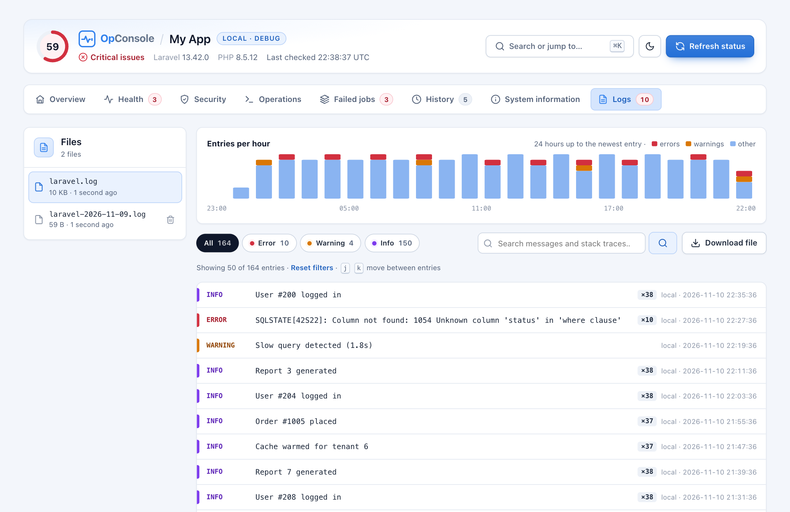
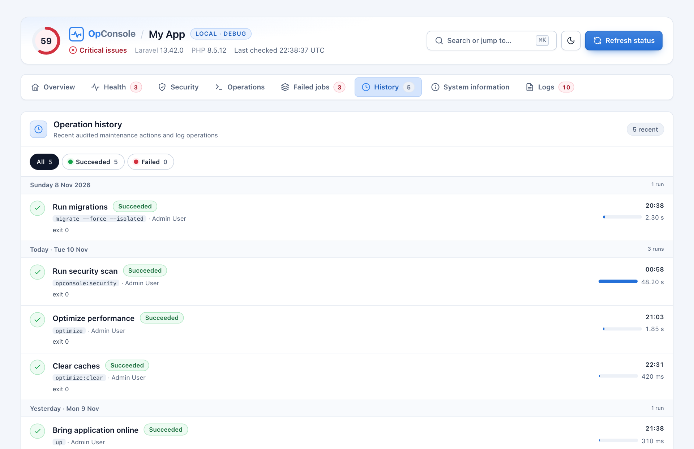

<p align="center"></p>

<p align="center"><strong>Monitor. Diagnose. Maintain.</strong><br>An operations console for Laravel: health checks, safe Artisan operations, a security audit and a log viewer, all behind Gates.</p>

<p align="center">
<a href="https://packagist.org/packages/ashraftalha/laravel-opconsole"></a>
<a href="https://packagist.org/packages/ashraftalha/laravel-opconsole"></a>
<a href="https://github.com/ashraftalha/laravel-opconsole/actions/workflows/tests.yml"></a>
<a href="LICENSE"></a>
<a href="https://opconsole.ashraftalha.com/reference/supported-versions"></a>
<a href="https://opconsole.ashraftalha.com/"></a>
</p>

<p align="center">📖 Full documentation: <a href="https://opconsole.ashraftalha.com/">https://opconsole.ashraftalha.com/</a></p>

<p align="center">

</p>

OpConsole adds one page to your app, `/admin/opconsole` by default. It answers "is anything wrong?" at a glance, shows the fix for every problem, and lets the right people run maintenance tasks without SSH. It ships its own CSS and JavaScript, needs no build step, and makes no CDN requests.

**Start here:** [5-minute setup](https://opconsole.ashraftalha.com/guide/quick-start) · [Read-only production](https://opconsole.ashraftalha.com/advanced/production-recipes#read-only-production-recommended) · [401/403 troubleshooting](https://opconsole.ashraftalha.com/reference/troubleshooting#access-and-actions-decision-tree)

No SSH? [Check shared-hosting limitations](https://opconsole.ashraftalha.com/guide/installation#shared-hosting-and-no-ssh-deployments): installation and migrations still need deployment access, and timed browser actions need web-runtime `pcntl`.

## Contents

- [What's inside](#whats-inside)
- [Requirements](#requirements)
- [Quick start](#quick-start)
- [Learn more](#learn-more)
- [Updating](#updating)
- [Testing](#testing)

## What's inside

The console is organised in eight tabs. A header above them shows a **0–100 health score**, the environment badge, and the Laravel and PHP versions.

| Tab | What you get |
|---|---|
| **Overview** | Overall state with a status bar, summary cards (database, health, log errors, cache, queue, scheduler, disk, security), the issues that need attention with copyable fix commands, runtime status, and recent activity. |
| **Health** | Every check grouped by area, critical issues first. Filter by status chips or by name, and expand any check to see its current value and fix. Filters stay in the URL (`?check_status=`), so a shared link opens the same view. |
| **Security** | Vulnerable Composer packages by severity, a scan-freshness meter, each advisory with a ready-to-copy `composer update` command, and Laravel configuration warnings. |
| **Operations** | Maintenance tasks split into a **Safe** group and a **Danger zone**. The output of the last run appears first. |
| **Failed jobs** | The newest failed queue jobs with their queue, failure time and error (never the payload), a filter, and a **Retry** button per job. |
| **History** | An audit trail grouped by day: who ran what, when, how long it took, and any error. |
| **System** | Application, PHP, performance (OPcache, JIT, Xdebug), PHP extensions, server, database, service and cache settings, with production-risk flags, copy buttons, a search box, and "Copy summary for support". |
| **Logs** | Log file list, an entries-per-hour chart, level and environment filters, search with highlighting, repeat counts, stack traces with your app's frames highlighted, download and delete. |

### Screenshots

<table>
<tr>
<td width="50%"><br><sub><b>Health</b>: filter by status, expand any check for its fix</sub></td>
<td width="50%"><br><sub><b>Operations</b>: safe tasks, a danger zone, and run one migration or all</sub></td>
</tr>
<tr>
<td width="50%"><br><sub><b>Security</b>: advisories by severity, scan freshness</sub></td>
<td width="50%"><br><sub><b>Logs</b>: hourly chart, filters, repeat counts</sub></td>
</tr>
<tr>
<td width="50%"><br><sub><b>History</b>: audit trail grouped by day</sub></td>
<td width="50%"><br><sub><b>Failed jobs</b>: errors at a glance, retry one job</sub></td>
</tr>
</table>

<sub>Screenshots use sample data.</sub>

**Also included:**
- Press <kbd>Ctrl</kbd>/<kbd>⌘</kbd> <kbd>K</kbd> to jump to any tab, check, operation or log file.
- Use <kbd>j</kbd> / <kbd>k</kbd> to move through log entries.
- Light and dark themes, with a per-visitor toggle.
- Right-to-left layout for Arabic, Hebrew, Persian and Urdu.
- Works on phones.
- Strict-CSP friendly: no inline `<script>` and no inline `style=`.

## Requirements

- PHP 8.3+
- Laravel 12 or 13
- **Optional, for browser operations:** the web PHP runtime needs the `pcntl` functions, which enforce the action timeout. Many PHP-FPM builds disable them. Without `pcntl`, everything else works, and the affected operations are disabled with an explanation. See [Execution environments](https://opconsole.ashraftalha.com/reference/configuration#execution-environments).
- **Optional, for the security audit:** Composer 2.4+ and a `composer.lock` in your app.

## Quick start

**1. Install the package**

```bash
composer require ashraftalha/laravel-opconsole
```

**2. Publish the config** (optional, but recommended)

```bash
php artisan vendor:publish --tag=opconsole-config
```

**3. Create the audit table**

```bash
php artisan migrate
```

**4. Open the console**

Sign in to your app, then go to `https://your-app.test/admin/opconsole`.

With `APP_ENV=local` it works right away. In every other environment, access is denied until you define the Gates below.

**5. Allow access in production**

Start with a trusted read-only operator. Import `Gate` at the top of `app/Providers/AppServiceProvider.php`, then define the Gates inside `boot()`:

```php
use Illuminate\Support\Facades\Gate;

// Inside boot(): replace this placeholder with a trusted operator's identity.
Gate::define('viewOpConsole', fn ($user) => $user->email === 'operator@example.com');
Gate::define('runOpConsoleActions', fn ($user) => false);
Gate::define('downloadOpConsoleLogs', fn ($user) => false);
Gate::define('deleteOpConsoleLogs', fn ($user) => false);
```

This permits dashboard and log-tail access but denies commands, job retries, full log downloads, and log deletion with the default configuration. Keep `authorization.action_gates` empty for this read-only policy: a mapped Gate for a normal Artisan action can grant execution even when the run Gate denies it. Failed-job retries additionally require the run Gate; see the [permission matrix](https://opconsole.ashraftalha.com/guide/authentication#effective-permission-matrix). Log tails may contain sensitive data, so viewing still requires a trusted operator.

When administrators need to execute actions, **replace** those definitions with a separate operator/admin policy:

```php
// Inside boot(): replace both placeholders with identities you control.
Gate::define('viewOpConsole', fn ($user) => in_array($user->email, [
    'operator@example.com',
    'admin@example.com',
], true));
Gate::define('runOpConsoleActions', fn ($user) => $user->email === 'admin@example.com');
Gate::define('downloadOpConsoleLogs', fn ($user) => $user->email === 'admin@example.com');
Gate::define('deleteOpConsoleLogs', fn ($user) => false);
```

The operator remains read-only; the administrator can run enabled actions (including migrations and job retries) and download logs. Log deletion stays disabled until explicitly granted. For an existing role or permission system, use equivalent permission checks instead of email addresses.

**6. Start the scheduler and a queue worker** (for the heartbeat checks)

```bash
* * * * * cd /path/to/app && php artisan schedule:run >> /dev/null 2>&1
php artisan queue:work
```

That's it.

Need finer permissions? Map individual operations to their own Gates (for example, support staff can clear caches while migrations stay with administrators). See [Authentication & Authorization](https://opconsole.ashraftalha.com/guide/authentication).

## Learn more

📖 The full documentation lives at **[opconsole.ashraftalha.com](https://opconsole.ashraftalha.com/)**.

| Topic | What it covers |
|---|---|
| [Authentication & Authorization](https://opconsole.ashraftalha.com/guide/authentication) | The four Gates, the fail-closed default, per-operation Gates, read-only users |
| [Operations](https://opconsole.ashraftalha.com/features/artisan-actions) | Every allow-listed operation, its risk, and the safety rules (confirmation, press-and-hold, locks, runtime limits, audit). Run all pending migrations or one at a time |
| [Failed jobs & retry](https://opconsole.ashraftalha.com/features/failed-jobs) | The failed-jobs tab and per-job retry |
| [Health checks & alerts](https://opconsole.ashraftalha.com/features/health-checks) | Built-in checks, the health score, and [alerts when health changes](https://opconsole.ashraftalha.com/features/health-checks#alerts-health-transition-notifications) |
| [CLI and JSON health endpoint](https://opconsole.ashraftalha.com/reference/artisan-commands) | `opconsole:health` for CI and the token-protected [endpoint for uptime monitors](https://opconsole.ashraftalha.com/reference/configuration#health-endpoint-health-endpoint) |
| [Security audit](https://opconsole.ashraftalha.com/features/security-checks) | Composer advisory scanning, `opconsole:security`, stale-result handling |
| [Laravel Octane & Swoole](https://opconsole.ashraftalha.com/features/octane-swoole) | Octane health checks, Reload Octane workers, why timed operations are refused inside Swoole workers |
| [Custom health checks](https://opconsole.ashraftalha.com/advanced/custom-health-checks) | Write your own check with the `HealthCheck` contract |
| [Configuration](https://opconsole.ashraftalha.com/reference/configuration) and [environment variables](https://opconsole.ashraftalha.com/reference/environment-variables) | Every option, including themes, your own Blade layout and a back link |
| [Production deployment](https://opconsole.ashraftalha.com/advanced/production-deployment) | Caching, lock stores on multiple servers, the audit policy |
| [Security model](https://opconsole.ashraftalha.com/reference/security) | How access, CSRF, the command allow-list and output sanitising work |
| [Troubleshooting](https://opconsole.ashraftalha.com/reference/troubleshooting) and [FAQ](https://opconsole.ashraftalha.com/reference/faq) | Common problems and questions |

## Updating

```bash
composer update ashraftalha/laravel-opconsole
php artisan migrate
php artisan config:clear
```

Composer never changes files you published. If you published any of them earlier:

- **Assets:** `php artisan vendor:publish --tag=opconsole-assets --force`
- **Views:** compare them with the new ones, or re-publish with `--tag=opconsole-views --force`.
- **Config:** copy over any new keys from the [latest config](config/opconsole.php). Re-publishing with `--force` overwrites your changes.

See the [changelog](CHANGELOG.md) for what changed and the [upgrade guide](https://opconsole.ashraftalha.com/reference/upgrade) for version-specific steps.

## Testing

```bash
composer test     # PHPUnit through Testbench
composer stan     # Larastan
composer pint     # code style
```

## Contributing

See [CONTRIBUTING.md](CONTRIBUTING.md).

## License

MIT. See [LICENSE](LICENSE).
